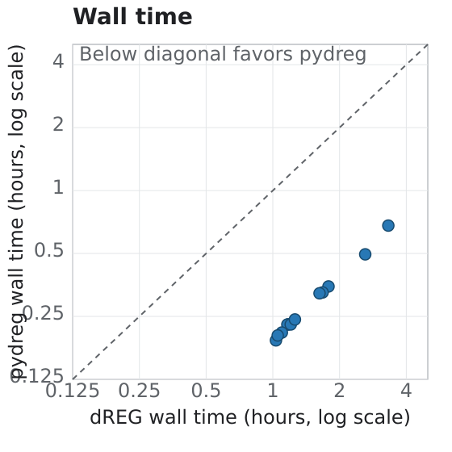
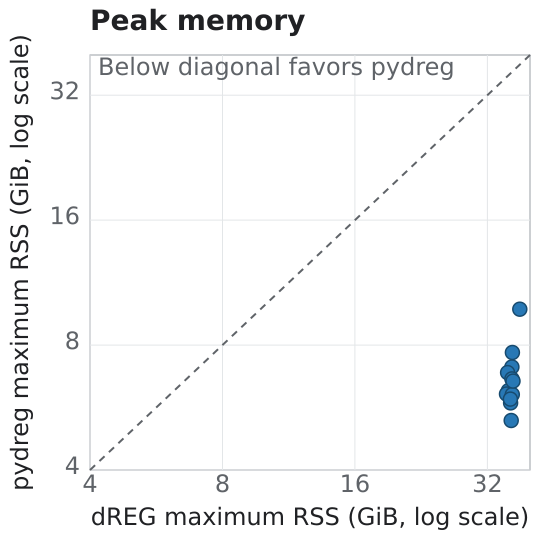

# pydreg

[](https://pypi.org/project/pydreg/)
[](https://github.com/adamyhe/pydreg/actions/workflows/ci.yml)
[](https://github.com/adamyhe/pydreg)
[](https://huggingface.co/adamyhe/pydreg)
[](https://pepy.tech/projects/pydreg)

An accelerated Python port of [dREG](https://github.com/Danko-Lab/dREG) (Danko Lab) — detects active transcriptional regulatory elements (promoters and enhancers) from PRO-seq/GRO-seq nascent-transcription data.

Given a pair of strand-specific bigWig files, pydreg scores every informative genomic position with a pretrained SVR model, then calls significant peaks with FDR control, mirroring the original R package's recommended `run_dREG.R` pipeline end to end.

## Performance

pydreg is substantially faster and less memory demanding than dREG. On an NVIDIA Titan Xp and 16 CPU cores, across 12 real PRO-seq/GRO-seq/ChRO-seq libraries we see a median 5.17x walltime speedup (range 4.88x-5.38x) and a median 5.67x reduction in peak RSS (range 3.89x-6.89x):

<p>
  
  
</p>

Peak calls from pydreg agree with official dREG peak calls at a median 0.99967 Jaccard index (range 0.99840-0.99991) across the same 12 libraries.

On other hardware, for one library (Jurkat ChRO-seq replicate 1, about 5M informative positions), with `--seed 0`:

| hardware | wall time | with `--tf32` | peak RSS | Jaccard vs dREG (`--tf32`) |
|---|---|---|---|---|
| NVIDIA L40S | 5.3 min | 4.4 min (1.21x) | 6.0 GiB | 0.99979 (0.99618) |
| NVIDIA RTX 3080 | 6.3 min | 5.0 min (1.26x) | 6.2 GiB | 0.99979 (0.99618) |
| NVIDIA A100 | 7.4 min | 4.9 min (1.51x) | 6.0 GiB | 0.99979 (0.99618) |
| NVIDIA Titan Xp | 13.7 min | n/a | 5.8 GiB | 0.99979 |
| Apple M5, `mlx` | 27.2 min | 18.1 min (1.50x) | 4.9 GiB | 0.99951 (0.99469) |

The NVIDIA runs used 16 CPU cores and the M5 run used its 10. dREG took 72 min on this library on the Titan Xp node. Peak calling runs on the CPU, so the host CPU matters too: the A100's node is slower than the L40S's here. Without `--tf32`, every NVIDIA GPU gives identical output. Full logs are in [`figures/benchmark_results/1.0/`](figures/benchmark_results/1.0/).

## Installation

```bash
pip install pydreg[gpu]   # Linux with an NVIDIA GPU
pip install pydreg[mlx]   # macOS with Apple Silicon
pydreg --help
```

Or, to install just the `pydreg` command into its own isolated environment with [uv](https://docs.astral.sh/uv/):

```bash
uv tool install pydreg[gpu]
```

To use the Python API in your own project, run `uv add pydreg[gpu]` there instead.

The `[gpu]` and `[mlx]` extras turn on GPU scoring, and pydreg picks the GPU up automatically when one is available. Neither extra is required, but scoring on the CPU is **much** slower, so it isn't generally recommended. Requirements:

- **NVIDIA (`[gpu]`):** compute capability 3.0 or newer, which covers essentially any CUDA GPU from the last decade, including older Pascal cards.
- **Apple Silicon (`[mlx]`):** any M1 or later Mac.

The pretrained models are downloaded from [Hugging Face](https://huggingface.co/adamyhe/pydreg) the first time they're needed and cached after that.

## Usage

```bash
pydreg plus.bw minus.bw out_prefix --cores 8 --verbose
```

`plus.bw` and `minus.bw` are strand-specific bigWigs of raw, unnormalized, 3′-mapped read counts. This is the same input dREG takes, and the Danko lab's [proseq2.0](https://github.com/Danko-Lab/proseq2.0/) pipeline produces it. The options most people will want:

| flag | what it does |
|---|---|
| `-p`, `--cores N` | CPU cores to use (default 1). Set this to as many as you can spare. |
| `--backend` | `auto` (default) picks the GPU if one is usable, otherwise the CPU. |
| `--tf32` | Faster on newer GPUs (A100, L40S, RTX 30-series and newer, Apple M5), but agrees slightly less closely with dREG. |
| `--seed N` | Makes peak calls exactly repeatable from run to run. |
| `-v`, `--verbose` | Print progress messages. |

From Python:

```python
from pydreg import pipeline

result = pipeline.run("plus.bw", "minus.bw", "out_prefix", cores=8)
```

The main output is `{out_prefix}.dREG.peak.full.bed.gz`, the significant peaks with their scores and p-values. pydreg also writes a per-position score bigWig and a few other peak tracks.

**[`docs/CLI.md`](docs/CLI.md)** has every option, the full list of output files and the Python API.

## Documentation

- [`docs/CLI.md`](docs/CLI.md) covers all options, output files and the Python API.
- [`docs/METHODS.md`](docs/METHODS.md) explains how the algorithm works, in plain language.
- [`docs/OPTIMIZATION.md`](docs/OPTIMIZATION.md) explains why pydreg is faster than dREG and how the backends differ.
- [`docs/PLANNING.md`](docs/PLANNING.md) and [`docs/PERF_LOG.md`](docs/PERF_LOG.md) are the detailed design and benchmark records, for contributors.

## Project status

pydreg is feature-complete and in maintenance mode. It implements dREG's full peak-calling workflow, and its output matches the original (see above). Future releases will cover:

- bug fixes;
- support for new dependency and Python versions;
- performance work that leaves output unchanged (or, for the randomized p-value step, unchanged within its existing noise).

**Out of scope by design:** training new models, and changes to dREG's algorithm or scoring. pydreg aims to reproduce dREG, including its known quirks, so that results stay comparable with the original. Method changes belong in a separate tool.

**Open to contributions:** performance and portability work is welcome, along with bug reports from new data types or platforms. See [`CHANGELOG.md`](CHANGELOG.md) for release history.

## Contributing

See [`CONTRIBUTING.md`](CONTRIBUTING.md) for development setup, running tests, and what to read before making algorithmic or performance changes.

## License

GPL-3.0 (matching the original dREG R package, which is GPL-3-licensed).

## Citation

If you use this package, please cite the pydreg preprint:

> He, A. Y., & Danko, C. G. (2026). pydreg: a fast Python package for identifying active cis-regulatory elements from nascent transcription. *bioRxiv*. https://doi.org/10.64898/2026.09.06.745329

Since pydreg is a port that reuses dREG's pretrained models and peak-calling procedure, please also cite the original dREG papers:

> Danko, C. G., Hyland, S. L., Core, L. J., Martins, A. L., Waters, C. T., Lee, H. W., Cheung, V. G., Kraus, W. L., Lis, J. T., & Siepel, A. (2015). Identification of active transcriptional regulatory elements from GRO-seq data. *Nature Methods*, 12(5), 433-438. https://doi.org/10.1038/nmeth.3329

> Wang, Z., Chu, T., Choate, L. A., & Danko, C. G. (2018). Identification of regulatory elements from nascent transcription using dREG. *Genome Research*, 29, 293–303. https://doi.org/10.1101/gr.238279.118

Please also cite the version number of this port to improve reproducibility.
