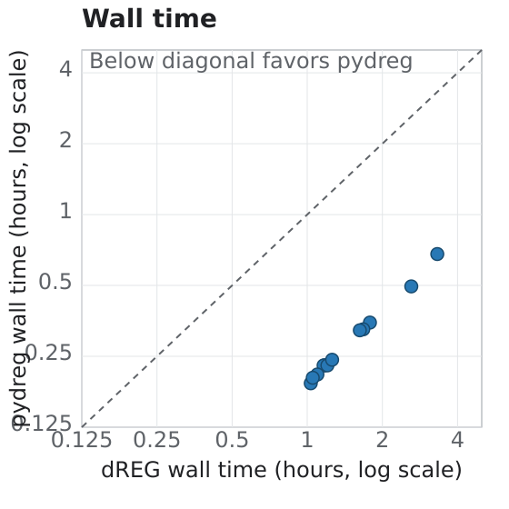
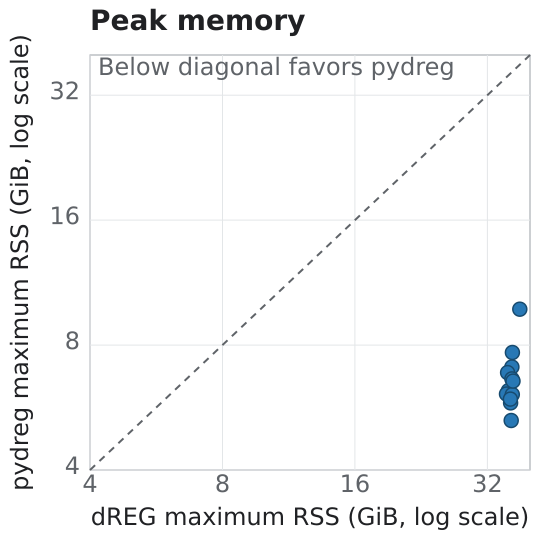
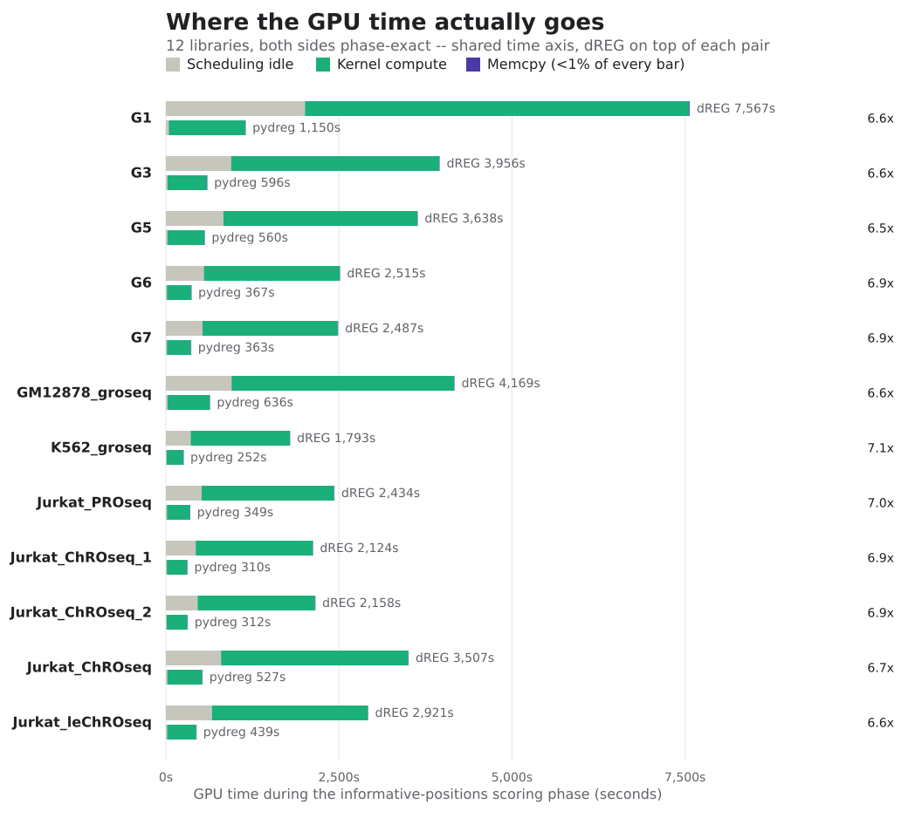
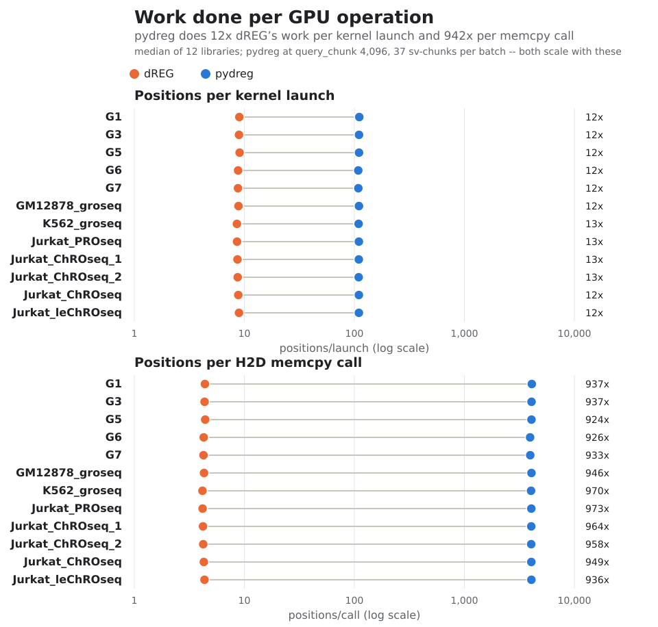
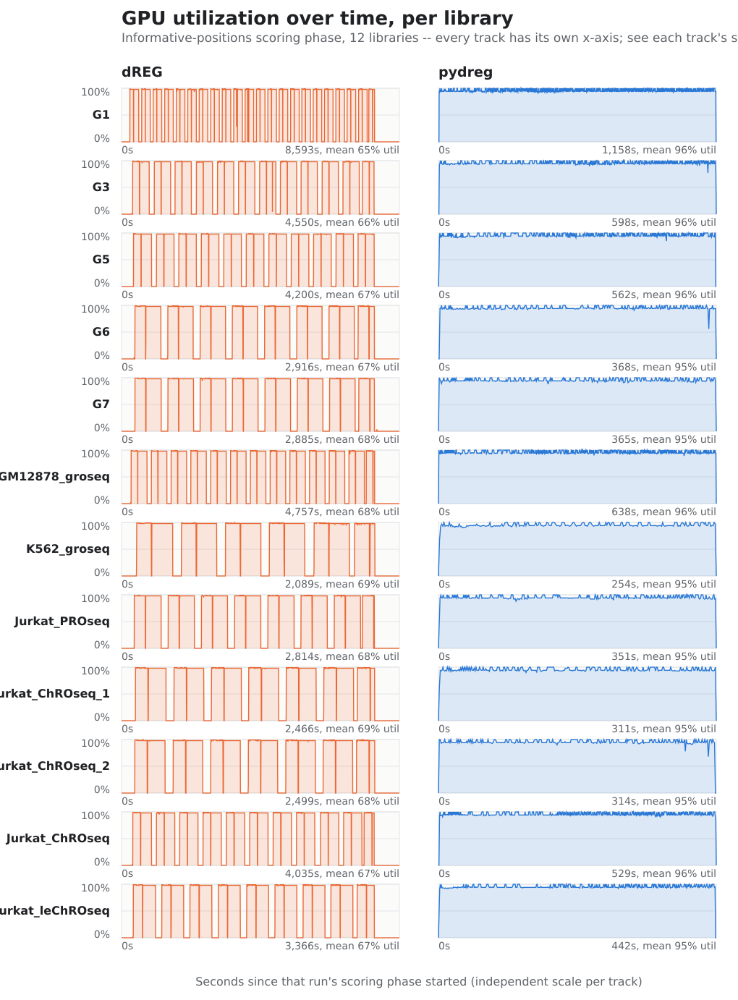

# Why pydreg is fast

This page explains where pydreg's speed comes from and why it's built the
way it is. It's written for users. If you're changing performance-related
code, [`PERF_LOG.md`](PERF_LOG.md) has the full history: every benchmark,
every idea that didn't work, and the evidence behind each claim here.

**The ground rule:** no speedup is allowed to change the output. Scores and
peaks must stay the same, including the dREG quirks that pydreg keeps on
purpose (see [`METHODS.md`](METHODS.md#things-to-know)). Every change is
checked against the test suite, and changes to peak calling are also
checked against real dREG output. The one step that is random (the peak
p-values) can't be identical run to run, so there the requirement is
"unchanged within its existing noise".

## Overall result

On an NVIDIA Titan Xp with 16 CPU cores, across 12 real libraries, pydreg
runs about **5x faster** than dREG and uses about **5.7x less memory** at
its peak:

  
  

### Other hardware

For one library (Jurkat ChRO-seq replicate 1, about 5M informative positions), with `--seed 0`:

| hardware | wall time | with `--tf32` | peak RSS | Jaccard vs dREG (`--tf32`) |
|---|---|---|---|---|
| NVIDIA L40S | 5.3 min | 4.4 min (1.21x) | 6.0 GiB | 0.99979 (0.99618) |
| NVIDIA RTX 3080 | 6.3 min | 5.0 min (1.26x) | 6.2 GiB | 0.99979 (0.99618) |
| NVIDIA A100 | 7.4 min | 4.9 min (1.51x) | 6.0 GiB | 0.99979 (0.99618) |
| NVIDIA Titan Xp | 13.7 min | n/a | 5.8 GiB | 0.99979 |
| Apple M5, `mlx` | 27.2 min | 18.1 min (1.50x) | 4.9 GiB | 0.99951 (0.99469) |

The NVIDIA runs used 16 CPU cores and the M5 run used its 10. dREG took 72 min on this library on the Titan Xp node. Peak calling runs on the CPU, so the host CPU matters too: the A100's node is slower than the L40S's here. Without `--tf32`, every NVIDIA GPU gives identical output. Full logs are in [`figures/benchmark_results/1.0/`](../figures/benchmark_results/1.0/).

## Where the time goes

A pydreg run spends most of its time in two places:

1. **Scoring** every informative position with the SVR model. That means
   comparing each position against all 605,187 of the model's support
   vectors. This runs on the GPU if you have one.
2. **Peak calling**, and especially the p-value for each peak. This runs on
   the CPU, spread across `--cores` worker processes.

Most of the work described below targets one of these two.

## Why dREG's GPU scoring is slower

dREG can also score on a GPU, so the gap isn't GPU versus CPU. The two
tools use the same card differently. Profiling both on all 12 libraries,
looking only at the scoring step, showed two separate reasons. Neither
explains the gap on its own.

**dREG's GPU sits idle a lot.** dREG alternates strictly between two
phases: first the CPU prepares a large round of positions, then the GPU
scores them. Nothing overlaps, so the GPU waits through every preparation
phase. dREG's GPU is idle for a median **22%** of the scoring step. pydreg
prepares the next batch while the GPU scores the current one (see
[Keeping the GPU busy](#keeping-the-gpu-busy)), so its GPU is idle for only
about **4%**. Average GPU utilization is 65-69% for dREG and 94-96% for
pydreg.

**Each of dREG's GPU operations does very little.** dREG's GPU library
(Rgtsvm) sends data to the GPU in pieces covering about 4 positions at a
time. Pieces that small are dominated by the fixed cost of starting each
transfer, not by the data itself. pydreg sends about 4,000 positions per
transfer. The computation is similar: about 9 positions per GPU operation
for dREG, about 110 for pydreg.

  
  

  

Counting only the time the GPU is actually working, dREG takes a median
**5.5x** longer than pydreg for the same work. Counting the idle time too,
it's **6.8x**. (pydreg 1.0.0 on a Titan Xp.)

pydreg's per-operation figures depend on its batch-size settings
(`--query-chunk`, `--cupy-sv-chunk`), so treat them as a description of the
default configuration, not a fixed property. dREG's have no setting that
changes them. `figures/gpu_profiling/README.md` explains how the profiling
was done and how to repeat it.

## Scoring backends

All four backends compute the same scores from the same model. They differ
only in where and how fast they run.

| backend | runs on | picked automatically? | notes |
|---|---|---|---|
| `cupy` | NVIDIA GPU (Linux) | yes, when a usable GPU is found | Install with `pydreg[gpu]`. Fastest option. |
| `mlx` | Apple Silicon GPU (macOS) | yes, when a usable GPU is found | Install with `pydreg[mlx]`. |
| `numpy` | CPU | yes, when no GPU is available | Much slower than a GPU, but needs nothing extra. |
| `sklearn` | CPU | never | Available for comparison, but about 40x slower than `numpy`. |

Every backend other than `numpy` checks its first batch of scores against
the `numpy` backend. If they disagree by more than a small tolerance, pydreg
stops with an error rather than producing wrong results. This check has
already caught real problems during development (see below).

### Why NumPy and not scikit-learn on the CPU

scikit-learn's SVR (which uses libsvm) compares one position with one
support vector at a time. pydreg's NumPy backend does the same arithmetic
as one large matrix multiply, plus one compiled step that combines the
results. That shape is fundamentally faster, not a matter of tuning. On an
Apple M4, scoring a batch of 4,096 positions took 269 s with scikit-learn
and 6.8 s with pydreg's NumPy backend (about 40x), and the two agreed to
about 1e-10.

The NumPy backend's main remaining cost used to be the step between the
matrix multiplies, which ran on a single core. It is now a compiled,
multi-core kernel (numba). That made CPU scoring about 3x faster on a
10-core Mac, and the kernel keeps speeding up with more cores on larger
machines.

### Why pydreg has its own GPU code instead of using cuML

pydreg 0.1 used RAPIDS cuML's SVR. It was dropped for two reasons:

- **Wrong answers on older GPUs, with no error.** cuML stopped supporting
  GPUs older than compute capability 7.0 (Pascal cards such as the Titan
  X), but a build installed on one doesn't fail. It runs and returns wrong
  scores: off by about 0.05 on a Titan X, while the same input on an A100
  matched dREG. No cuML release supported both older GPUs and the feature
  pydreg needed.
- **No way to use float32.** cuML's conversion path was fixed at float64,
  which is slow on consumer GPUs.

pydreg's GPU backends are instead the NumPy backend's formula, run on the
GPU with CuPy or MLX. Because it's the same formula and not a separate
library, there's nothing to convert and no minimum GPU generation beyond
what CuPy itself supports (compute capability 3.0).

### Keeping the kernel matrix off the GPU's memory

Scoring computes a huge table of similarities between positions and
support vectors, then sums each row. Writing that table out to GPU memory
and reading it back is slow. pydreg's GPU backends compute each similarity
and add it to the row's total immediately, inside one custom GPU kernel,
so the full table is never stored. This made each scoring batch 1.2-1.3x
faster on most NVIDIA cards (1.05x on an A100, whose float32 matrix
multiply was already the bottleneck) and about 1.25-1.3x faster on Apple
M4 and M5.
It also moved scores slightly *closer* to the exact float64 answer, since
the row totals are now added up in double precision.

### GPU precision: float32 and TF32

**float32 is safe here.** GPUs, especially consumer ones, are much faster
at float32 (single precision) than at float64, so pydreg's GPU backends use
float32. That sounds like a loss of accuracy, but it isn't one in practice:
dREG's models were trained with Rgtsvm, which works in float32 throughout.
The model's numbers were never more precise than float32 to begin with.
GPU scores differ from the float64 CPU scores by at most about 5e-4, and
GPU runs still agree with dREG's peaks at 0.9998 Jaccard. Apple GPUs
have no float64 at all, so float32 is the only choice there anyway.

The CPU backends stay in float64. The original R package scored with
libsvm, which is float64 throughout, so float32 on the CPU would be a real
loss of accuracy compared with the original, and the speed argument for
float32 only applies to GPUs.

**TF32 is off unless you ask for it.** Newer GPUs (NVIDIA A100, L40S and
RTX 30-series and later, and Apple M5) can run float32 matrix multiplies
in a faster, lower-precision mode called TF32. Some libraries turn this on
by default. pydreg turns it off, because it measurably reduces agreement
with dREG. On one library (Jurkat ChRO-seq replicate 1), peak agreement
dropped from 0.9998 to 0.996 Jaccard on NVIDIA and from 0.9997 to 0.995 on
an M5. The same peaks are found, but their edges shift. Results also start
to differ between GPU models.

`--tf32` turns it on if you prefer the speed: about 1.5x faster end to end
on an A100 and an M5, and 1.2x on an L40S. It has no effect on older GPUs,
which don't have TF32. Without `--tf32`, every NVIDIA GPU tested gives
identical output.

### Batch size settings

`--cupy-sv-chunk` and `--mlx-sv-chunk` control how many support vectors
each GPU call handles. Both default to 16,384.

- **NVIDIA:** scoring speed was flat across every setting tried, from
  4,096 up to no batching at all, because this step is limited by memory
  speed, not by how often work is launched. Larger settings only use more
  GPU memory. 16,384 is the largest value that doesn't raise memory use;
  the old default of 32,768 used about 45% more.
- **Apple Silicon:** speed is flat up to about 32,768 but drops beyond
  that, up to 2x slower at very large settings. Very large settings can
  also crash, because Metal limits the size of any single buffer to about
  9.5 GB regardless of how much memory the Mac has.

## Keeping the GPU busy

Before scoring, the CPU has to read each batch of positions from the
bigWig files and build their 360-number descriptions. If the GPU waited
for that every time, it would sit idle much of the time. That's exactly
what happened once the GPU scoring got fast.

pydreg prepares the next batch in a background thread while the GPU
scores the current one. The faster the GPU, the more this matters. On an
A100, scoring is only about 1.5x slower than preparation, so without this
overlap the GPU would be idle a large fraction of the time.

Preparing each batch has also been made faster:

- **Compiled binning.** Counting reads into bins is a compiled, multi-core
  routine (numba), 2-4x faster than the original NumPy version.
- **Smarter grouping of reads.** pydreg reads each stretch of the genome
  once and reuses it for every nearby position. Previously, isolated
  positions far apart could get grouped together, making pydreg read
  megabases of empty genome between them. Now positions are only grouped
  when their windows actually overlap. This mostly matters for sparse
  positions, where the old grouping had made preparation the slowest part
of the run.
- **Both strands at once.** The plus and minus strands for each group are
  read at the same time, at no extra memory cost.

Preparing several groups in parallel was tried and not adopted: it used
about 1.2 GB of extra memory, for too little gain.

## Peak calling

### Parallel workers

Each broad candidate region is called independently, so peak calling
spreads regions across `--cores` worker processes, a block of
`--peak-calling-block-width` regions at a time. Each worker uses a single
math-library thread, because the matrices involved are tiny (5×5). Letting
every worker also start its own math threads would only make them fight
over the same cores.

### The p-value: same answer, about 150x faster

Each peak's p-value is a five-dimensional probability that has to be
estimated by sampling (see [`METHODS.md`](METHODS.md#4-peak-calling)).
Before optimization, this was over 97% of peak-calling time. Three changes
made it about 150x faster per peak (from about 3 s to about 17 ms), without
changing the result beyond the sampling's own noise:

1. **Match R's precision, not more.** SciPy's default settings for this
   calculation are 100-200x more precise than the settings the original R
   code uses. pydreg uses R's settings, which was the biggest single win.
2. **Stop redoing the same setup.** The sampling pattern was being rebuilt
   hundreds of times per peak with identical inputs. It's now built once
   and reused.
3. **Start small and add samples as needed, like R does.** SciPy always
   starts with a large number of samples. R starts with a few and adds
   more only until the answer is precise enough. pydreg now does the
   same, which is much cheaper for the many peaks that converge quickly.

On a full Jurkat PRO-seq run, this cut peak calling from 509 s to 289 s
and the whole run from 20.4 to 16.8 minutes.

### An optional shortcut that is on by default

Each p-value is a sum of 290 terms, and the later terms are usually tiny.
pydreg can stop adding terms once the rest are *guaranteed* to add up to
less than a set tolerance, `--pmv-laplace-tail-tol` (default `1e-6`).

Two things make this safe:

- The guarantee is mathematical, not a guess: each term has a known upper
  limit that doesn't depend on the data.
- Leaving terms out can only make a p-value slightly *larger*. A peak can
  therefore only become less significant, never falsely significant.

A simpler idea was tried first and rejected. Skipping every other term, or
other evenly spaced terms, looked fine on typical data. But on 60 test
cases built to sit right at the significance threshold, it turned every
one of them falsely significant. The bounded shortcut showed no effect on
those same cases.

On a full real run, the shortcut called exactly the same peaks (33,350) as
the exact calculation, with essentially the same agreement with dREG
(0.99932 vs 0.99934 Jaccard), and made the whole run 1.2x faster. That
result is why it's the default. `--pmv-laplace-exact` turns it off.

### The random-forest peak splitter

The small random forest that decides whether to split neighboring peaks is
evaluated by pydreg's own compiled code, not by scikit-learn. pydreg calls
it many times on tiny inputs, often 1-20 rows at a time. scikit-learn's
forest has a fixed overhead of 10-25 ms per call regardless of input size,
while pydreg's version takes microseconds. (For inputs of thousands of
rows, scikit-learn would win, but pydreg never makes calls that large.)

## One `--cores` setting for everything

`--cores` sets the parallelism of every stage at once: the compiled
multi-core routines in feature preparation and position scanning, the
number of peak-calling workers, and the number of threads the math library
(BLAS) uses. Having one number avoids a common problem, where one stage
uses only the cores you asked for while another quietly grabs every core
on the machine.

## Smaller improvements

- **Finding informative positions** is about 2x faster, after two slow
  steps were replaced: a sort used only to remove duplicate positions, and
  a NumPy sum that was inefficient for very short windows.
- **Loading the model** takes about 2-2.7 s instead of 7-9 s. The model
  file is now decompressed and read directly in memory, instead of through
  a temporary file and a slow per-tensor reader. The loaded model is
  bit-for-bit identical.
- **Writing output files** happens in parallel, since the files don't
  depend on each other. A large debugging-only output (a BED copy of the
  per-position scores) was dropped.

## Troubleshooting: "CUDA versions below 12 are not supported"

Since version 14, CuPy no longer includes the CUDA toolkit. It looks for
one on the system instead. On a machine that has an NVIDIA driver but no
separately installed toolkit, it then fails with a confusing message
claiming the CUDA version is too old, even when `nvidia-smi` reports
CUDA 12. (`nvidia-smi` reports what the driver supports, not whether a
toolkit is installed.) pydreg's `[gpu]` extra installs CuPy with its
`[ctk]` option, which pulls in the toolkit as ordinary pip packages. If you
install CuPy yourself, install `cupy-cuda12x[ctk]`.

## Reproducing these results

- `scripts/bench_backends.py` compares the scoring backends on your own
  hardware.
- `scripts/bench_numpy_backend_threading.py` checks how the CPU backend's
  math library and compiled kernel share cores on your machine.
- `figures/gpu_profiling/` has the GPU profiling scripts behind the
  figures above.
- [`PERF_LOG.md`](PERF_LOG.md) has exact numbers, dates and dead ends for
  every change summarized here.
